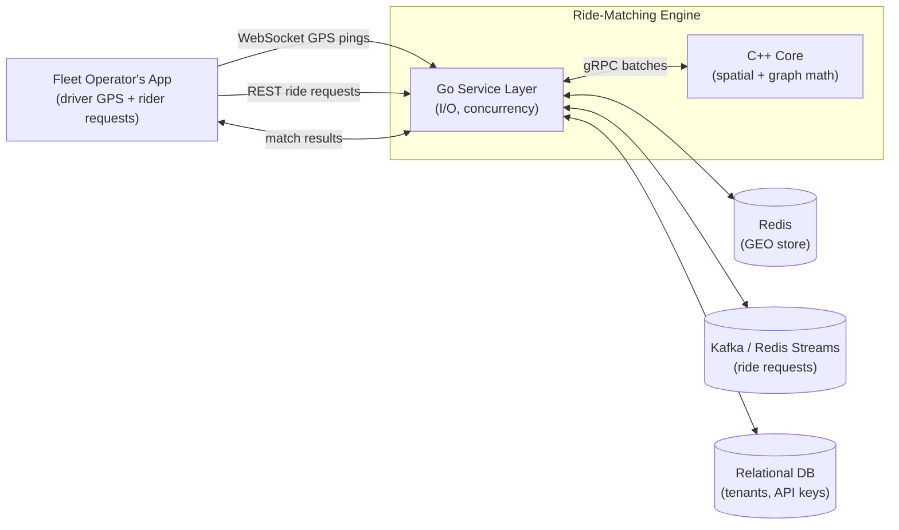
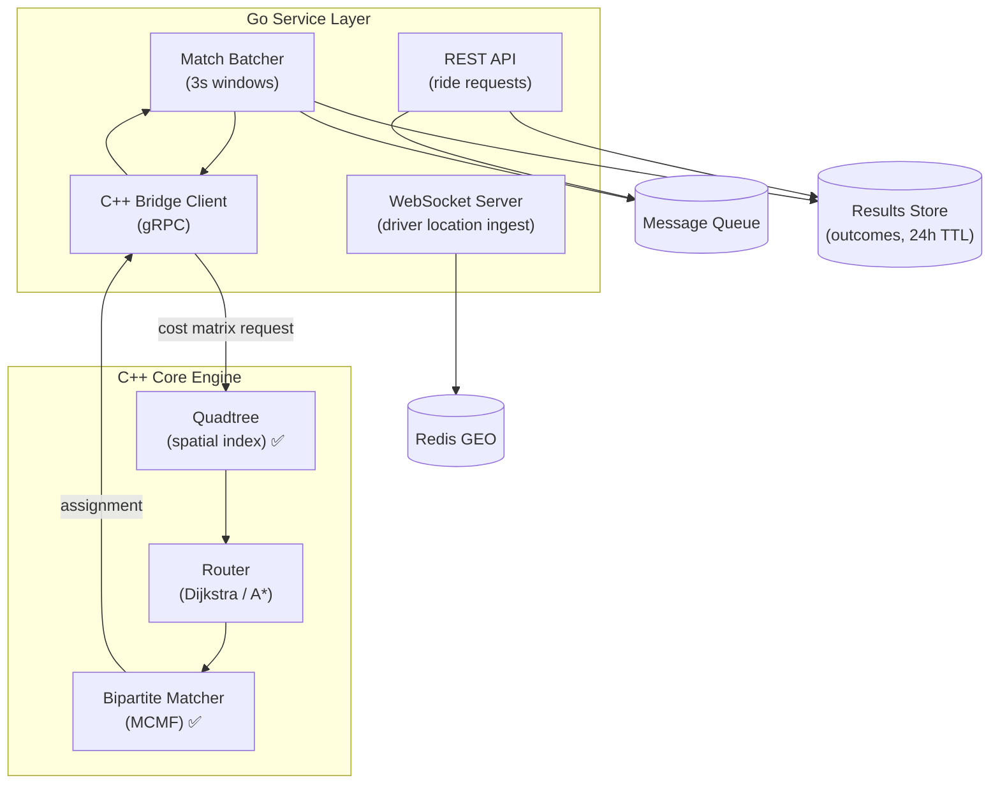
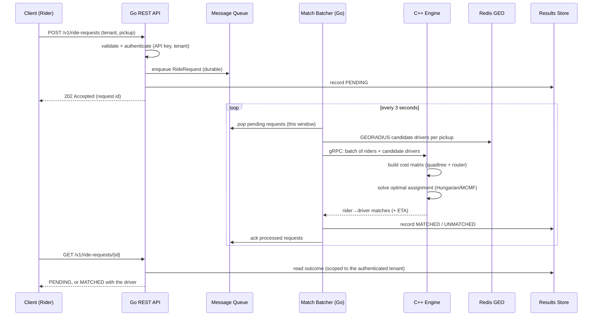
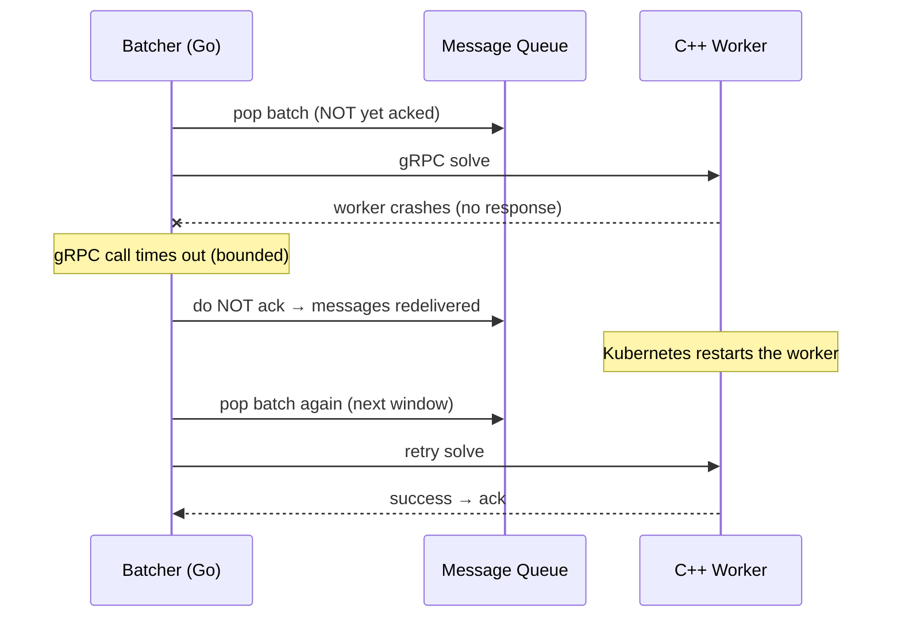

# Architecture & Data Flow

**Status:** Draft · **Related:** [Technical_Design_Document.md](Technical_Design_Document.md), [Data_Model.md](Data_Model.md)

Diagrams use [Mermaid](https://mermaid.js.org/), which GitHub and most IDEs render natively.

---

## 1. System Context (C4 Level 1)

## 2. Component View (C4 Level 2)

Legend: ✅ = implemented (Quadtree Week 2, MCMF matcher Week 3). Everything else is scheduled per the TDD.

The results store is written by **both** the API (`PENDING` on accept) and the
batcher (the terminal state), and read only by the API. It is the one piece of
state that outlives a request's presence in the queue — by design, since the
queue holds work and deletes it on completion, while an outcome is only useful
*after* the work is done.

## 3. The Critical Path: a ride request end-to-end

Two things in that diagram are easy to skim past and are the whole design:

**The batcher never talks to the rider.** An earlier version of this diagram
drew `B-->>Rider: match result`, and that arrow was fiction — the batcher has
no connection to the client and never did. The rider polls. There is no push
channel in v1: no webhook, no rider socket. Anything drawn as a push here would
be a diagram describing software that does not exist.

**The write to the results store precedes the ack.** Ack-then-record loses the
match outright on a crash, because the ack is what deletes the request. 
Record-then-ack merely duplicates work: the request is redelivered, re-matched,
and the record overwritten. That ordering is why at-least-once delivery is safe
here rather than merely tolerable.

## 4. Failure & resiliency flow

This is the concrete realization of the **Fail-Safe Orchestration** tenet: requests are only acked *after* a successful match, so a crash re-processes rather than drops.

## 5. Key architectural boundaries

| Boundary | Contract | Why it matters |
|----------|----------|----------------|
| Client ↔ Go | [REST](api/rest-openapi.yaml) + WebSocket | public, versioned, must stay stable |
| Go ↔ C++ | [gRPC/proto](api/matching.proto) | hardest to change; defined before either side is coded |
| Go ↔ Redis/Queue/DB | repository interfaces | mockable, swappable in tests |

## 6. Scaling model

- **Go services are stateless** → scale horizontally behind a load balancer (HPA in K8s).
- **C++ workers are stateless per batch** → scale as a worker pool; a crash affects only its in-flight batch.
- **Redis / queue / DB** are the stateful tier → scaled independently, with the queue providing the durability guarantee.
